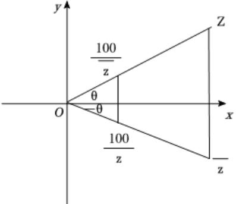

由已知结合棱锥的定义检验充分及必要性即可求解.

本题主要考查了棱锥的定义在充分必要条件判断中的应用，属于中档题.

3. 已知复数 $ z $满足 $ |z| = 26 $，且当复平面上以 $ z, \overline{z}, \frac{100}{z}, \frac{100}{z} $对应的点为顶点的四边形面积最大时，与 $ 2|Re(z)| $最接近的整数为( )

A. 36

B. 37

C. 38

D. 39

【答案】B

【解析】解：设 $ z = 26(cos\theta + i\sin\theta) $，则 $ \overline{z} = 26(cos\theta - i\sin\theta) $，

 $ \frac{100}{z} = \frac{50}{13} (cos\theta - isin\theta), \quad \frac{100}{\bar{z}} = \frac{50}{13} (cos\theta + isin\theta) $. 如图，

四边形面积为 $ S = \frac{1}{2}|26^2 - (\frac{100}{26})^4| \cdot |sin2\theta| $，

当 $ |sin2\theta|=1 $，即 $ 2\theta=\frac{\pi}{2} $或 $ \frac{3\pi}{2} $， $ \theta=\frac{\pi}{4} $或 $ \frac{3\pi}{4} $时面积最大，

2|Re(z)| = 2 × 26 ×  $ \frac{\sqrt{2}}{2} $ = 26 $ \sqrt{2} $ ≈ 36.77，最接近37.

故选：B.

设出复数z，然后求解四边形的面积，通过最大值，求解z，即可推出结果.

本题考查复数的几何意义，是中档题.

4. 已知定义域为  $ R $ 的函数  $ y = f(x) $ 和  $ y = g(x) $，对  $ t \in R $，记  $ M(t) = \{x | x \in R, f(x) > g(t)\} $。有两个命题：

①若对任意 $ a > b $，都有 $ M(a) \supset M(b) $，则 $ y = g(x) $严格减；

②设 $ t>0 $，若对任意 $ b\in R $，都存在正整数i，使得 $ M(b)=M(b+it) $，则 $ y=g(x) $是周期函数。

则( )

A. ①真②真 B. ①真②假 C. ①假②真 D. ①假②假

【答案】B